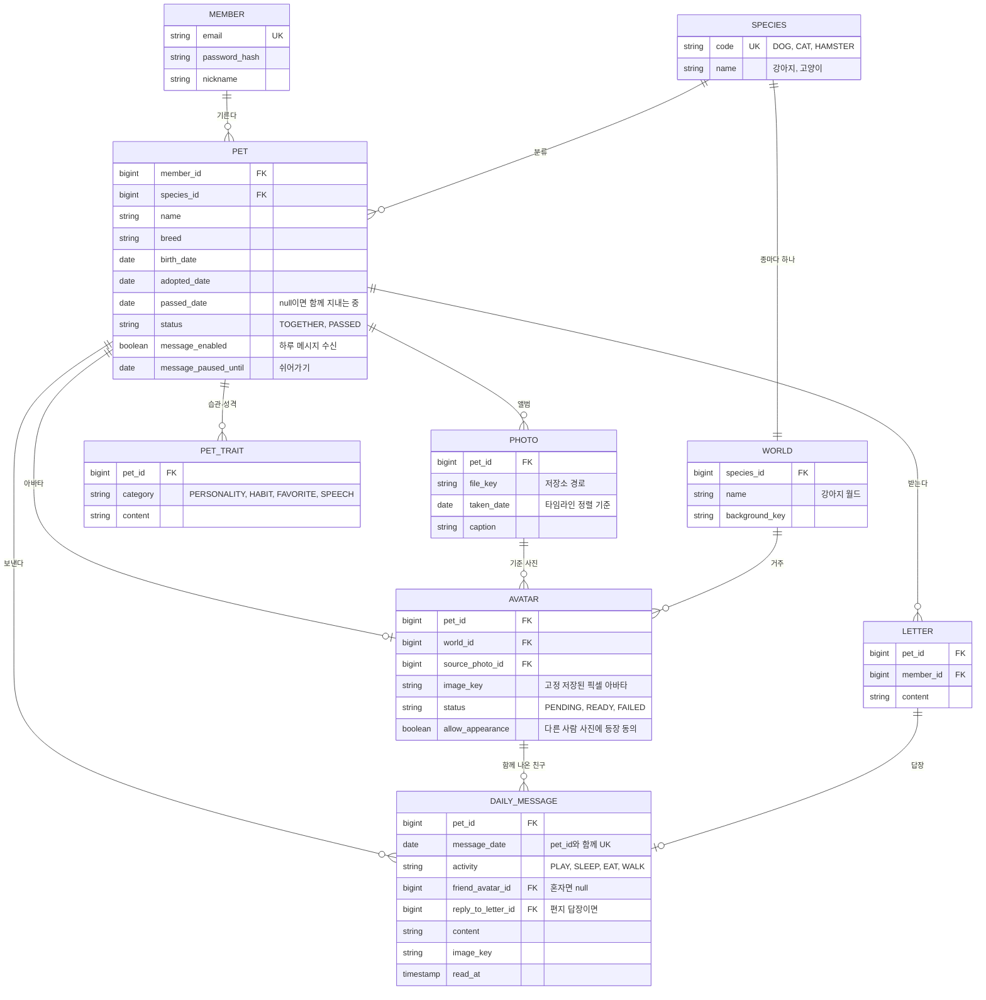
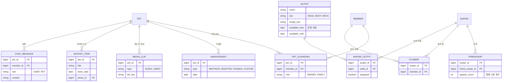

# pawse ERD (초안)

관련 문서: [개요](overview.md) · [API](api.md)

모든 테이블은 `id`(bigint, PK), `created_at`, `updated_at`을 가진다. 아래에는 생략한다.
IntelliJ의 Markdown 미리보기에서 Mermaid 플러그인을 켜면 그림으로 보인다.

## MVP (1~6단계)

### 설계 메모

- **PET.status**: "이별 준비"와 "이별 후"를 한 테이블에서 구분한다. 화면과 메시지 말투가 이 값으로 갈린다.
- **SPECIES와 WORLD 분리**: 지금은 1:1이지만 계절 이벤트 월드(F17)가 생기면 한 종에 월드가 여러 개가 된다. 그때 `WORLD`에 기간 컬럼만 더하면 된다.
- **AVATAR는 PET당 하나**: 다시 만들면 기존 행의 이미지를 교체한다. 이력이 필요해지면 그때 분리한다.
- **DAILY_MESSAGE (pet_id, message_date) 유니크**: 스케줄러가 두 번 돌아도 하루 한 통만 생긴다.
- **이미지는 DB에 넣지 않는다**: 파일 저장소 경로(`*_key`)만 저장한다.

## 이후 단계

가족 공유(F15)를 넣을 때 `PET.member_id`를 `PET_GUARDIAN`으로 옮긴다. MVP에서는 소유자 한 명으로 단순하게 둔다.
